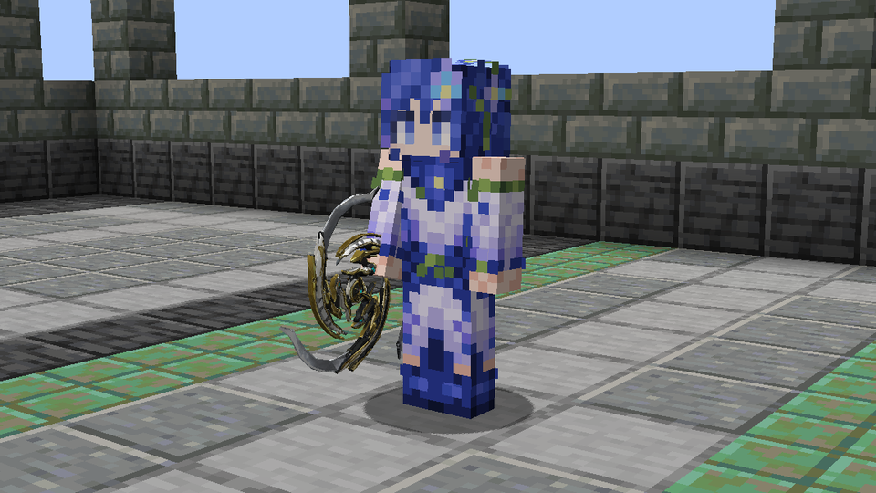
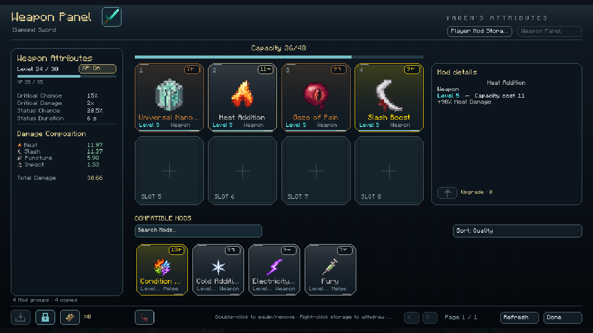
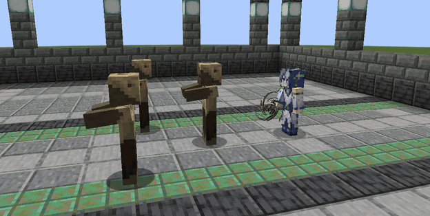
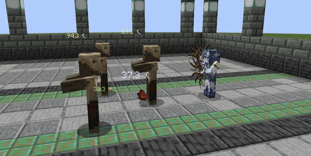

# Yagen's Attributes

Warframe-inspired weapon builds for Minecraft. Equip Mods, combine elements, and build weapons around critical hits, status effects, or multishot.

**Minecraft 1.21.1 · NeoForge · Java 21**

[Releases](https://github.com/WaitMyDawn/yagens_attributes/releases) · [中文](README.zh-CN.md) · [Player guide](docs/player-guide.md)

*Delphinium skin by Yagen. Glaive Prime is from the optional companion mod [Tennory](https://github.com/WaitMyDawn/tennory).*

## Build your weapons

- **Make a build.** Slot Mods for damage, elements, critical hits, status effects, or weapon handling. Installed Mods stay in your Mod collection and can be moved between compatible weapons.
- **See what hits.** Physical and elemental damage interact with different targets and shields. Thirteen status effects have their own visuals and stack counters. Critical tiers have distinct damage-number colors.
- **Grow into your build.** Level a weapon to earn capacity, double its capacity with a Catalyst, or use Forma to change a slot's polarity. Upgrade Mods with Endo and reroll weapon-specific Rivens with Kuva.

## In-game showcase

| Glaive Prime | Quassus Prime |
| :---: | :---: |
|  |  |
| Throw, detonate, and catch | Paired warfan strikes and two blade volleys |

*Recorded with Tennory for the weapons and Better Combat for the melee animations. Yagen’s Attributes supplies the damage numbers and status effects.*

## Quick start

1. Hold a Mod item and right-click to deposit it. Press **Shift+M** to browse your collection.
2. Hold a supported weapon and press **Shift+Y**. Turn on **Absorb Experience** beside the weapon level to give earned XP to the weapon first. As it levels up, it gains capacity. Any XP your held weapons cannot absorb goes to you.
3. Drag a compatible Mod into a slot, or double-click the card to equip it. Right-click an equipped card to return it to storage. Hold **Shift** over an inventory weapon to see its current stats.

## Progression and compatibility

Look for Mods and Endo in loot chests. Endermen can drop Forma, Ancient Cities can yield Veiled Rivens, and a crafted Orokin Catalyst permanently doubles a weapon’s rank-based capacity. [Acquisition, combat rules, and HUD settings](docs/player-guide.md)

Vanilla weapons work alongside supported weapons from **Tennory**, **L_Ender’s Cataclysm**, **Twilight Forest**, and **Iron’s Spells ’n Spellbooks**. Tennory integration covers Glaive Prime, Redeemer Prime, and Quassus Prime, including their special attacks. [Tennory’s weapon guide](https://github.com/WaitMyDawn/tennory#weapons)

## Resources

[Data pack reference](docs/player-guide.md#data-packs) · [Build workflow](.github/workflows/build.yml) · [Issues](https://github.com/WaitMyDawn/yagens_attributes/issues) · [License](LICENSE.md)
