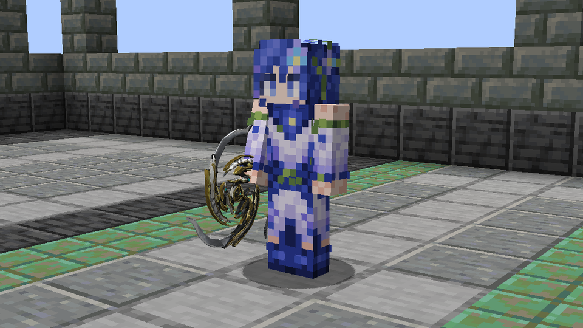
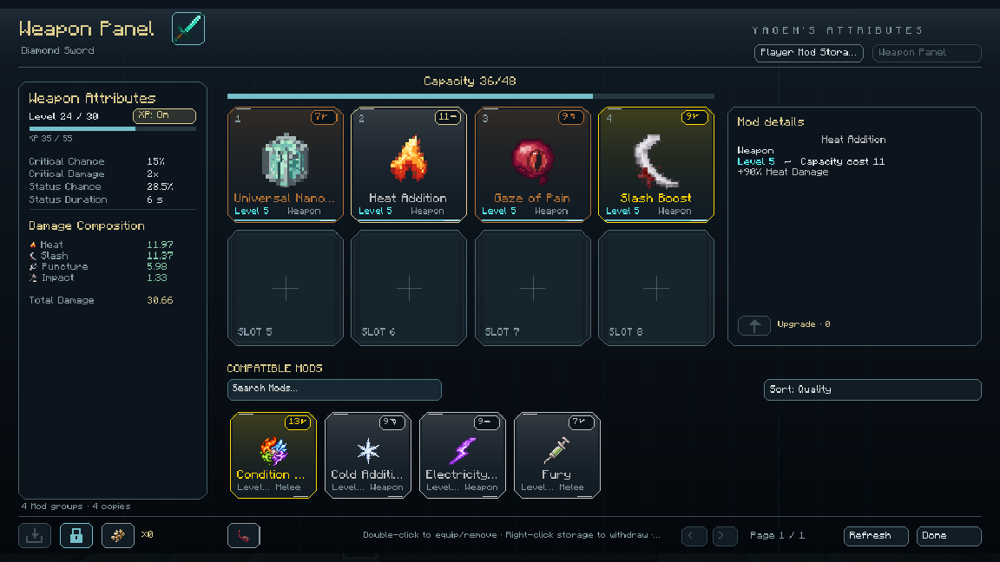
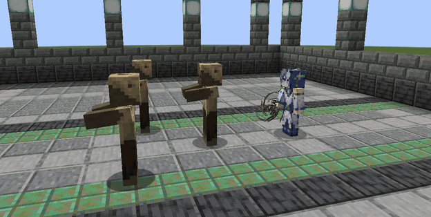
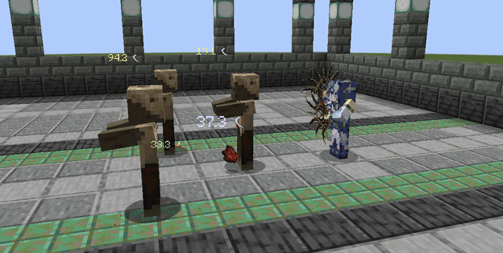

# Yagen's Attributes

把《Warframe》式的武器配装带进 Minecraft。装上 Mod、组合元素，让武器围绕暴击、触发或多重射击成型。

**Minecraft 1.21.1 · NeoForge · Java 21**

[下载](https://github.com/WaitMyDawn/yagens_attributes/releases) · [English](README.md) · [玩家指南](docs/player-guide.zh-CN.md)

*翠雀皮肤由 Yagen 绘制。战刃 Prime 来自可选联动模组 [Tennory](https://github.com/WaitMyDawn/tennory)。*

## 武器配装

- **按打法配卡。** 用 Mod 强化基伤、元素、双爆、双触或武器的操作属性。装配的 Mod 仍归你所有，可以换到其他适用武器上。
- **看见每一击。** 不同的物理和元素伤害对生命材质、护盾有不同效果。十三种触发各有特效和层数提示，伤害数字用颜色区分暴击等级。
- **养成你的武器。** 升级提高容量，用奥罗金催化剂翻倍，用塑形块改变槽位极性。内融核心可以升级 Mod，赤毒用来循环武器专属的裂罅词条。

## 实机演示

| 战刃 Prime | 威震武扇 Prime |
| :---: | :---: |
|  |  |
| 掷出、引爆与回手 | 双扇普攻与两段飞刃齐射 |

*演示武器来自 Tennory，普攻动画使用 Better Combat。伤害数字和状态特效来自 Yagen’s Attributes。*

## 快速上手

1. 手持 Mod 右键存入仓库，用 **Shift+M** 打开 Mod 空间。
2. 手持可装配的武器，按 **Shift+Y** 打开武器面板。在等级旁开启**经验吸收**，获得的经验优先用于手持武器升级。升级会增加容量，武器吸收不了的经验归玩家。
3. 将适用的 Mod 拖进槽位，或双击卡片装配。右键已装配的卡片可将它放回仓库。在物品栏里按住 **Shift** 查看武器的当前属性。

## 进阶与联动

探索战利品箱获取 Mod 和内融核心，击败末影人获取塑形块，在远古城市寻找未知裂罅。用镓合成奥罗金催化剂，可永久翻倍武器的等级容量。 [材料获取、战斗规则与 HUD 设置](docs/player-guide.zh-CN.md)

除原版武器外，本模组也支持 **Tennory、灾变、暮色森林和铁魔法**中已接入的武器。Tennory 的战刃 Prime、救赎者 Prime 和威震武扇 Prime 均支持武器专属动作结算。 [Tennory 武器指南](https://github.com/WaitMyDawn/tennory#weapons)

## 相关资源

[数据包参考](docs/player-guide.zh-CN.md#数据包) · [构建流程](.github/workflows/build.yml) · [问题反馈](https://github.com/WaitMyDawn/yagens_attributes/issues) · [许可证](LICENSE.md)
